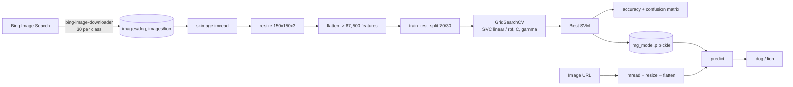

# Image Classification - Dog vs Lion with SVM

> Build-your-own image dataset from Bing, turn pixels into features and classify images with a grid-searched Support Vector Machine - then predict any image from a URL.

    

[](https://colab.research.google.com/github/Hemanth9336/Image-Classification-SVM-Dog-vs-Lion/blob/main/Image_Classification.ipynb) `Image_Classification.ipynb`  

## TL;DR

An end-to-end mini computer-vision pipeline: it **downloads its own dataset** (30 dog + 30 lion photos from Bing), resizes every image to 150x150 pixels, flattens each into **67,500 numbers**, and trains a **Support Vector Machine** whose settings are chosen automatically by **GridSearchCV** (12 combinations of linear/RBF kernels). The model is saved with pickle and can classify **any image from a URL** (e.g. a golden retriever photo -> *dog*). Test accuracy on 18 held-out images: **61%** - a deliberately small baseline that shows why modern vision uses CNNs and pre-trained embeddings.

## What is this project? (explained for non-AI readers)

To a computer, a photo is just a grid of coloured dots (pixels), each with a red, green and blue number. This project shrinks every photo to 150 x 150 dots and lines up all the numbers into one long list (67,500 numbers). It then shows the computer lists labelled *dog* or *lion* and asks it to find a rule that separates them. Because the computer only sees raw colours (not ears, manes or snouts) and had just 42 training photos, it is right about 6 times out of 10 - which is exactly why modern AI uses **deep learning** and **pre-trained models** that already understand shapes and objects.

## The problem it solves

Classify an image into one of two categories (dog / lion) without hand-labelled public datasets, demonstrating the complete workflow: data collection -> preprocessing -> hyper-parameter search -> evaluation -> model persistence -> inference on new images.

**Why it matters in the real world:**

- Image classification powers medical imaging, quality inspection, retail visual search and wildlife monitoring.
- Teaches the core idea that every image is a vector of numbers - the basis of image embeddings and multimodal LLMs.
- Shows automatic hyper-parameter tuning (GridSearchCV) and model saving/loading (pickle).
- Provides a clear baseline to measure the gain from CNNs, transfer learning and CLIP.

## Results at a glance

| Metric | Value |
|---|---|
| Dataset | 60 images (30 dog, 30 lion) from Bing |
| Train / test | 42 / 18 images (70/30, random_state=102) |
| Features per image | 67,500 (150 x 150 x 3 RGB, scaled 0-1) |
| Model selection | GridSearchCV over 12 SVM configurations, 5-fold CV |
| Test accuracy | **61.1%** (11 / 18) |
| Confusion matrix (rows = predicted, cols = actual) | [[6, 2], [5, 5]] |
| Sample inference | Golden-retriever URL -> **dog** (correct) |

- With only 42 training images and raw pixels, the SVM mostly learns colour/background statistics (e.g. savanna tones for lions).
- Using a pre-trained CNN or CLIP embedding instead of raw pixels typically pushes the same dog-vs-lion task above 95%.

## Architecture



More detail: [Architecture](docs/ARCHITECTURE.md) | [High-Level Design](docs/HLD.md) | [Low-Level Design](docs/LLD.md) | [Model Details](docs/MODEL_DETAILS.md)

## Technologies used

| Technology | What it is used for |
|---|---|
| Python 3 / Google Colab | Notebook runtime |
| bing-image-downloader | Automated dataset collection from Bing Images |
| scikit-image | `imread` (files and URLs) and `resize` |
| NumPy | Image arrays, flattening, label arrays |
| scikit-learn | `train_test_split`, `SVC`, `GridSearchCV`, accuracy, confusion matrix |
| Matplotlib | Class distribution bar chart, image display |
| pickle | Saving and loading the trained model |
| ipython-autotime | Cell execution timing |

## Dataset

| Property | Value |
|---|---|
| Name | Custom dog vs lion image set |
| Source | Bing Images via `bing-image-downloader` (`limit=30`, `adult_filter_off=True`) |
| Size | 60 images (30 per class), resized to 150 x 150 x 3 |
| Target | Class index: 0 = dog, 1 = lion |

- Images are not stored in the repo - they are downloaded fresh in the notebook, so results vary slightly per run.
- Web-scraped images include varied backgrounds, cartoons and text overlays (noisy labels).

## Repository structure

```text
Image-Classification-SVM-Dog-vs-Lion/
├── Image_Classification.ipynb                    # Full pipeline: download -> preprocess -> GridSearch SVM -> evaluate -> pickle -> URL inference
├── requirements.txt                              # Python dependencies
├── docs/                                         # Architecture, HLD, LLD, model details, AI primer, slide deck
```

## How to run

**Colab (recommended):** click *Open in Colab* above and *Run all*. At the last cell paste any image URL of a dog or lion.

**Local:**

```bash
git clone https://github.com/Hemanth9336/Image-Classification-SVM-Dog-vs-Lion.git
cd Image-Classification-SVM-Dog-vs-Lion
pip install -r requirements.txt
jupyter notebook Image_Classification.ipynb   # change DATADIR '/content/images' to 'images'
```

## How this project prepares for GenAI / future AI work

Modern multimodal AI (GPT-4o, Claude, Gemini) still starts where this project starts: an image becomes a vector of numbers. The difference is *how good* that vector is. Replacing flattened pixels with **pre-trained image embeddings** (CNN / CLIP / ViT) is the single biggest upgrade, and those embeddings unlock **image search in vector databases** and **zero-shot classification by text prompt**.

| GenAI skill | Connection |
|---|---|
| Embeddings & vector DBs | Swap the 67,500 raw pixels for a 512-dim CLIP embedding; store embeddings in FAISS/Chroma to search 'find images like this one'. |
| Pre-training vs fine-tuning | Use a CNN/ViT pre-trained on ImageNet (transfer learning) and fine-tune only the last layer on the 60 images. |
| GPT architecture / attention | Vision Transformers (ViT) apply the same self-attention as GPT to 16x16 image patches instead of words. |
| Prompt engineering | CLIP zero-shot: compare the image embedding with text prompts 'a photo of a dog' vs 'a photo of a lion' - no training needed. |
| GenAI | Multimodal LLMs can classify *and explain* ('It is a lion: tawny coat, mane, savanna background'); diffusion models can generate extra training images. |
| Fine-tuning vs prompting vs RAG | Tiny dataset -> prompting a vision LLM or CLIP zero-shot often beats training from scratch. |

Full beginner guide covering GPT/attention, pre-training vs fine-tuning, RLHF, hallucination, context windows, RAG, embeddings & vector DBs, LangChain/LangGraph, prompt engineering, agents and more: [docs/AI_ML_GENAI_PRIMER.md](docs/AI_ML_GENAI_PRIMER.md)

## Known limitations & next steps

**Limitations**

- Only 60 images; results depend heavily on what Bing returns.
- Raw pixel features - no shape, edge or texture understanding.
- No data augmentation, no class-probability threshold analysis.
- Best grid-search parameters are not printed or logged.

**Next steps**

- Print `clf.best_params_` and cross-validation scores.
- Replace raw pixels with HOG, pre-trained CNN (MobileNet/ResNet) or CLIP embeddings.
- Increase to 300+ images per class with augmentation (flip, crop, colour jitter).
- Serve with Gradio/Streamlit and add CLIP zero-shot classification for any label.

## Documentation & presentation

| Document | What you will find |
|---|---|
| [ARCHITECTURE.md](docs/ARCHITECTURE.md) | System diagram, layers, data flow, deployment view |
| [HLD.md](docs/HLD.md) | Goals, scope, components, data flow, non-functional requirements |
| [LLD.md](docs/LLD.md) | Step-by-step module design, data schemas, functions, parameters |
| [MODEL_DETAILS.md](docs/MODEL_DETAILS.md) | Each model explained: how it works, hyper-parameters, metrics |
| [AI_ML_GENAI_PRIMER.md](docs/AI_ML_GENAI_PRIMER.md) | Beginner guide to AI/ML/GenAI and how this project connects |
| [Image_Classification_SVM.pptx](docs/presentation/Image_Classification_SVM.pptx) | Slide deck summarising the project |

## Author

**Hemanth Phani Sai Mothukuri** - [GitHub @Hemanth9336](https://github.com/Hemanth9336)

*Skills: AI Automation & Integration | GenAI | AI Agents | AI Tools | Python | RAG | LangChain/LangGraph | Prompt Engineering*
