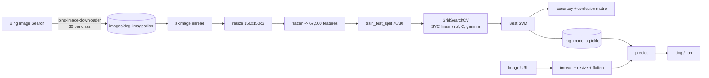
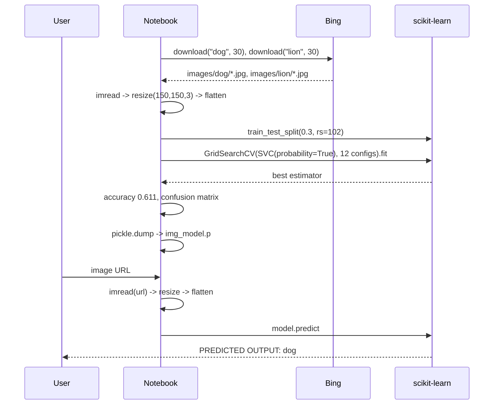
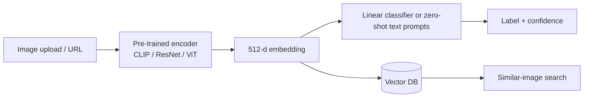

# Architecture - Image Classification - Dog vs Lion with SVM

> **Docs:** [README](../README.md) | [Architecture](ARCHITECTURE.md) | [HLD](HLD.md) | [LLD](LLD.md) | [Model Details](MODEL_DETAILS.md) | [AI Primer](AI_ML_GENAI_PRIMER.md) | [Presentation](presentation/Image_Classification_SVM.pptx)

## 1. System context

A Colab notebook that builds its own dataset from the web, trains an SVM on raw pixels, persists the model and offers an interactive 'paste an image URL' prediction step.

## 2. Architecture diagram

## 3. Layered view

| Layer | Responsibility | Implementation |
|---|---|---|
| Acquisition layer | Download images per category | bing-image-downloader |
| Storage layer | Local folders `images/dog`, `images/lion` | Colab filesystem |
| Preprocessing layer | Read, resize to 150x150x3, scale 0-1, flatten | scikit-image, NumPy |
| Model layer | SVC with hyper-parameter grid search | scikit-learn |
| Persistence layer | `img_model.p` | pickle |
| Inference layer | URL -> preprocess -> predict -> label | scikit-image + model |

## 4. End-to-end data flow

## 5. Deployment view

Runs in Google Colab; the pickled model could be loaded into a Streamlit/Gradio app or FastAPI endpoint for serving.

## 6. Target (production / GenAI-ready) architecture

A modern embedding-based version:

