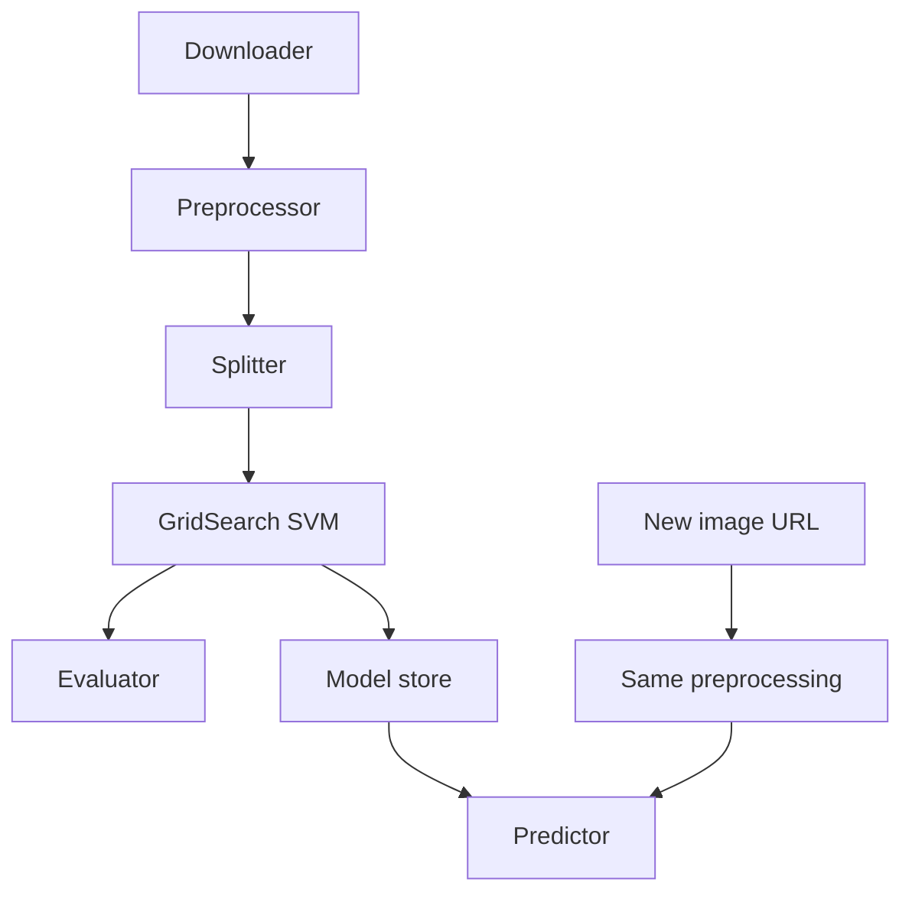

# High-Level Design (HLD) - Image Classification - Dog vs Lion with SVM

> **Docs:** [README](../README.md) | [Architecture](ARCHITECTURE.md) | [HLD](HLD.md) | [LLD](LLD.md) | [Model Details](MODEL_DETAILS.md) | [AI Primer](AI_ML_GENAI_PRIMER.md) | [Presentation](presentation/Image_Classification_SVM.pptx)

## 1. Purpose

Demonstrate a complete, beginner-friendly image classification workflow - from building a dataset to predicting new images - using classic ML.

## 2. Goals
- Automate dataset creation from the web.
- Classify dog vs lion images.
- Select SVM hyper-parameters automatically.
- Save the model and predict on arbitrary image URLs.

## 3. Scope

**In scope**

- Two classes
- Raw-pixel features
- SVM with grid search
- Pickle persistence
- URL inference

**Out of scope**

- Deep learning / CNNs
- Data augmentation
- Web UI
- Large-scale datasets

## 4. Major components

| Component | Responsibility | Technology |
|---|---|---|
| Image Downloader | Fetch N images per category | bing-image-downloader |
| Preprocessor | Read, resize, normalise, flatten | scikit-image, NumPy |
| Splitter | Train/test split | scikit-learn |
| Model Tuner | GridSearchCV over SVC configs | scikit-learn |
| Evaluator | Accuracy, confusion matrix | scikit-learn |
| Model Store | Serialise / deserialise model | pickle |
| Predictor | Classify image from URL | scikit-image + SVM |

## 5. High-level pipeline

| Stage | What happens |
|---|---|
| 1. Collect | Download 30 images each for 'dog' and 'lion' from Bing. |
| 2. Read | `skimage.io.imread` each file. |
| 3. Resize | `resize(img, (150,150,3))` - also scales pixel values to 0-1. |
| 4. Flatten | `img_resized.flatten()` -> 67,500-length vector; label = category index. |
| 5. Split | 70/30 with `random_state=102` -> 42 train / 18 test. |
| 6. Tune | GridSearchCV over linear (C=1,10,100,1000) and RBF (C x gamma=0.001,0.0001) kernels. |
| 7. Evaluate | Accuracy and confusion matrix on test images. |
| 8. Persist | `pickle.dump(clf, open('img_model.p','wb'))`. |
| 9. Infer | Read an image from a URL, preprocess identically, predict and print the class name. |

## 6. Data design (high level)

Three arrays are built: `images` (N x 150 x 150 x 3), `flat_data` (N x 67,500, float 0-1) and `target` (N, ints 0/1). Only `flat_data` and `target` feed the model.

## 7. Non-functional requirements

| Attribute | How it is addressed |
|---|---|
| Simplicity | Single notebook, few dependencies, runs on free Colab CPU. |
| Reproducibility | `random_state=102` for split; dataset itself changes with Bing results. |
| Reusability | Model pickled for reuse outside the notebook. |
| Extensibility | Add categories by extending `CATEGORIES` and downloading more images. |

## 8. Key design decisions

| Decision | Rationale |
|---|---|
| Scrape own data | Shows real-world data collection rather than a pre-packaged dataset. |
| 150x150 resize | Uniform input size; balances detail and feature count. |
| SVM with grid search | Strong classic classifier for high-dimensional data; tuning avoids guesswork. |
| probability=True | Enables confidence scores via `predict_proba`. |

## 9. Risks & mitigations

| Risk | Mitigation |
|---|---|
| Tiny dataset (60 images) | Download hundreds per class; add augmentation. |
| Raw pixels ignore shape | Use HOG features, CNN features or CLIP embeddings. |
| Noisy web images | Manually review / filter downloaded images. |
| Grayscale/RGBA images break resize to 3 channels | Convert with `skimage.color.gray2rgb` / drop alpha before resizing. |
