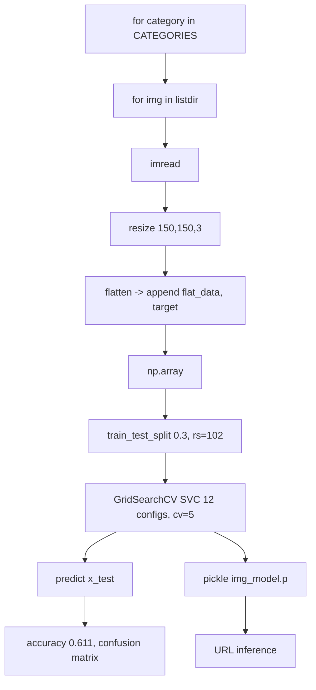

# Low-Level Design (LLD) - Image Classification - Dog vs Lion with SVM

> **Docs:** [README](../README.md) | [Architecture](ARCHITECTURE.md) | [HLD](HLD.md) | [LLD](LLD.md) | [Model Details](MODEL_DETAILS.md) | [AI Primer](AI_ML_GENAI_PRIMER.md) | [Presentation](presentation/Image_Classification_SVM.pptx)

## 1. Module / notebook breakdown

| Module | Responsibility |
|---|---|
| Setup | `pip install ipython-autotime bing-image-downloader`; `mkdir images` |
| Download | `downloader.download('dog', limit=30, output_dir='images', adult_filter_off=True)` and same for 'lion' |
| Preprocessing loop | For each category/file: imread -> resize -> flatten -> append |
| Visualise | `np.unique(target, return_counts=True)` + bar chart |
| Split | `train_test_split(flat_data, target, test_size=0.3, random_state=102)` |
| Grid search | `GridSearchCV(svm.SVC(probability=True), param_grid)` |
| Evaluate | `accuracy_score`, `confusion_matrix` |
| Persist | `pickle.dump` / `pickle.load` |
| Predict from URL | `input()` URL -> imread -> resize -> flatten -> predict -> `CATEGORIES[idx]` |

## 2. Input data schema

| Field | Type | Description |
|---|---|---|
| DATADIR | path | `/content/images` |
| CATEGORIES | list[str] | ['dog', 'lion'] - index = label |
| images | ndarray (N,150,150,3) | Resized images |
| flat_data | ndarray (N,67500) float | Model input |
| target | ndarray (N,) int | 0 = dog, 1 = lion |

## 3. Detailed processing flow



### 3.1 Preprocessing

```python
for category in CATEGORIES:
    class_num = CATEGORIES.index(category)
    path = os.path.join(DATADIR, category)
    for img in os.listdir(path):
        img_array = imread(os.path.join(path, img))
        img_resized = resize(img_array, (150, 150, 3))   # also rescales to [0, 1]
        flat_data.append(img_resized.flatten())          # 67,500 values
        images.append(img_resized)
        target.append(class_num)
```

### 3.2 Hyper-parameter grid

```python
param_grid = [
    {'C': [1, 10, 100, 1000], 'kernel': ['linear']},
    {'C': [1, 10, 100, 1000], 'gamma': [0.001, 0.0001], 'kernel': ['rbf']},
]
clf = GridSearchCV(svm.SVC(probability=True), param_grid)   # 12 configs x 5 folds = 60 fits
clf.fit(x_train, y_train)
```

### 3.3 Inference from URL

```python
img = imread(url)                       # scikit-image reads http(s) URLs directly
img_resized = resize(img, (150, 150, 3))
y_out = model.predict([img_resized.flatten()])
print('PREDICTED OUTPUT:', CATEGORIES[y_out[0]])
```

## 4. Key functions / interfaces

| Function / Object | Input | Output | Notes |
|---|---|---|---|
| `downloader.download(query, limit, output_dir)` | search term | image files | Bing scraping |
| `imread(path_or_url)` | file path / URL | ndarray HxWxC | scikit-image |
| `resize(img, (150,150,3))` | ndarray | 150x150x3 float | Anti-aliased, scaled 0-1 |
| `GridSearchCV.fit` | x_train, y_train | best SVC | 5-fold CV |
| `pickle.dump / load` | model / file | file / model | Persistence |
| `model.predict` | 1 x 67,500 | class index | Map via CATEGORIES |

## 5. Configuration & hyper-parameters

| Parameter | Value | Where / why |
|---|---|---|
| Images per class | 30 | `limit` in downloader |
| Image size | 150 x 150 x 3 | Feature length 67,500 |
| test_size / random_state | 0.3 / 102 | Split |
| SVM C grid | 1, 10, 100, 1000 | Regularisation |
| SVM gamma grid (RBF) | 0.001, 0.0001 | Kernel width |
| CV folds | 5 (default) | GridSearchCV |

## 6. Error handling & edge cases

- Downloaded files that are not valid images (HTML, GIF frames) can raise errors in `imread` - wrap in try/except.
- Grayscale or RGBA images: resizing to 3 channels may fail or distort - convert colour space first.
- URLs requiring authentication or blocking scrapers cannot be read by `imread`.
