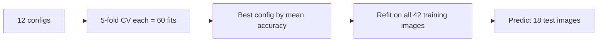

# Model Details - Image Classification - Dog vs Lion with SVM

> **Docs:** [README](../README.md) | [Architecture](ARCHITECTURE.md) | [HLD](HLD.md) | [LLD](LLD.md) | [Model Details](MODEL_DETAILS.md) | [AI Primer](AI_ML_GENAI_PRIMER.md) | [Presentation](presentation/Image_Classification_SVM.pptx)

A single model family - Support Vector Machine - is tuned with GridSearchCV over 12 configurations.

## Summary

| Model | Family | Result |
|---|---|---|
| Support Vector Machine (SVC) with GridSearchCV | Kernel max-margin classifier | Test accuracy **61.1%** (11/18). Confusion matrix (pred x actual): [[6, 2], [5, 5]]. |

## Support Vector Machine (SVC) with GridSearchCV

**Family:** Kernel max-margin classifier

### How it works (plain English)

Each image is a point in 67,500-dimensional space. The SVM finds the boundary that separates dog points from lion points with the largest margin. A **linear** kernel draws a flat boundary; an **RBF** kernel measures similarity between images and can draw curved boundaries. `C` controls how much misclassification is tolerated; `gamma` controls how far each training image's influence reaches. GridSearchCV trains all 12 combinations with 5-fold cross-validation and keeps the best.

### Hyper-parameters used

| Parameter | Value | Meaning |
|---|---|---|
| kernel | linear \| rbf | Boundary shape |
| C | 1, 10, 100, 1000 | Penalty for errors |
| gamma (rbf) | 0.001, 0.0001 | Influence radius |
| probability | True | Enable predict_proba |
| cv | 5 | Folds |

### Result

Test accuracy **61.1%** (11/18). Confusion matrix (pred x actual): [[6, 2], [5, 5]].

### Strengths
- Works with very few samples
- Automatic hyper-parameter selection
- Probability outputs

### Weaknesses
- Raw pixels carry no notion of shape/texture
- Slow for large image sets
- Sensitive to background/colour bias

## Evaluation metrics explained

| Metric | Meaning |
|---|---|
| Accuracy | Share of test images labelled correctly. |
| Confusion matrix | Counts of correct/incorrect predictions per class (here rows = predicted, columns = actual). |
| Cross-validation score | Mean accuracy across 5 folds used by GridSearchCV to choose the best configuration. |

## Full results

| Metric | Value |
|---|---|
| Dataset | 60 images (30 dog, 30 lion) from Bing |
| Train / test | 42 / 18 images (70/30, random_state=102) |
| Features per image | 67,500 (150 x 150 x 3 RGB, scaled 0-1) |
| Model selection | GridSearchCV over 12 SVM configurations, 5-fold CV |
| Test accuracy | **61.1%** (11 / 18) |
| Confusion matrix (rows = predicted, cols = actual) | [[6, 2], [5, 5]] |
| Sample inference | Golden-retriever URL -> **dog** (correct) |

- With only 42 training images and raw pixels, the SVM mostly learns colour/background statistics (e.g. savanna tones for lions).
- Using a pre-trained CNN or CLIP embedding instead of raw pixels typically pushes the same dog-vs-lion task above 95%.
